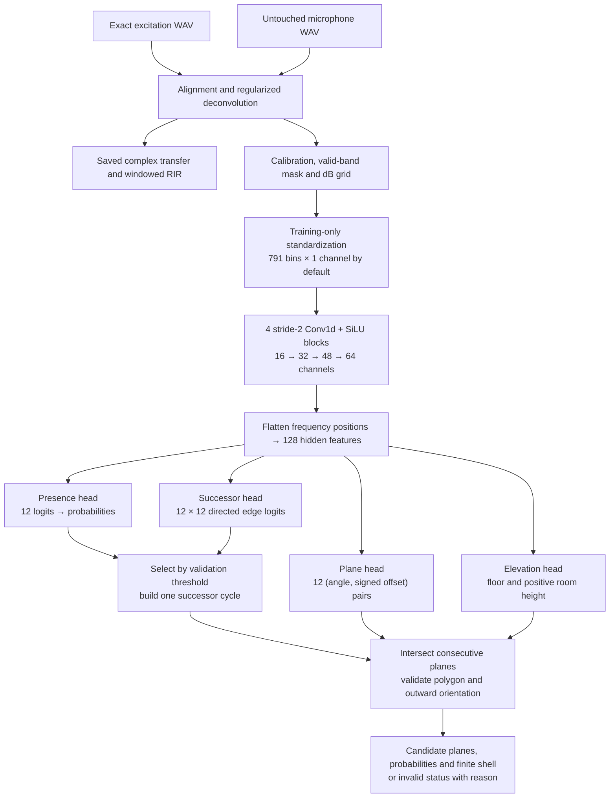
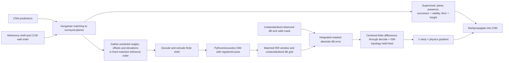

# Acoustic room geometry inference

Research prototype for inferring a vertical **room shell** from one laptop-recorded sweep. It predicts wall planes and finite boundary faces, not furniture or freestanding pillars. Audacity acquisition and RealityScan registration/annotation are manual. The remaining steps are scripted.

## Architecture



The last convolution has a 69-bin receptive field before flattening. The wall head represents an outward vertical plane as `(cos θ, sin θ, 0, d)`, for `n · x + d = 0`. The decoder greedily links selected slots by predicted successor score without closing a premature cycle. It intersects consecutive plane pairs rather than intersecting half-spaces, so concave footprints are supported. Parallel adjacent planes, self-intersection, and inconsistent outward normals can invalidate a decode. No reference geometry resolves inference failures.



Physics training **teacher-forces wall membership/connectivity** through the reference assignment. The simulator differentiates the *predicted* continuous geometry only: `P = 2 × matched wall count + 2` parameters, usually `1 + 2P` simulator calls per included example. The custom backward applies the incoming loss scale, including batch averaging and λ. No gradients act through hard presence or successor choices. Invalid base geometry or persistently invalid perturbations skip that example's physics term, not its supervised term or its later evaluation.

## Run

Requires Python 3.14 and [uv](https://docs.astral.sh/uv/). The lock file includes PyRoomAcoustics 0.10.1.

```sh
uv sync --locked
uv run --locked python -m pytest -q
uv run main.py config runs/config.json
uv run main.py physics-check runs/physics-check.json
uv run main.py synthetic runs/synthetic --config runs/config.json
uv run main.py train runs/synthetic/dataset.json runs/pretrain --config runs/config.json
uv run main.py evaluate runs/synthetic/dataset.json runs/pretrain/best.pt runs/synthetic-test
```

After collecting and annotating takes:

```sh
uv run main.py preprocess capture/manifest.json runs/measured --config runs/config.json
uv run main.py train runs/measured/dataset.json runs/baseline --config runs/config.json --init runs/pretrain/best.pt
uv run main.py evaluate runs/measured/dataset.json runs/baseline/best.pt runs/baseline-test
uv run main.py infer capture/sweep.wav capture/take.wav runs/baseline/best.pt runs/inference --excitation-channel 0 --recording-channel 0
```

Omit `--init` for direct real-data training. Fine-tuning initializes weights only and fits standardization again on the new training rooms. Keep consistent physical room IDs across datasets: pretraining is rejected if a prior training or validation room appears in the new holdouts. For leave-one-room-out, rerun with `--test-room ROOM` and choose a disjoint `--val-room ROOM`; tune only inside each fold's training/validation partition. Without explicit room IDs, the seeded split holds out roughly 20% of rooms each for validation and test. At least three distinct rooms are required.

For a physics comparison, copy the baseline config and set `training.physics_weight` to a moderate nonzero value (for example `0.005` as a pilot starting point, not a tuned value). Use the same architecture, initialization, preprocessing, and split. Compare held-out `metrics.json` files; inspect `history.json` for actual physics coverage.

Use a new output directory for each training run. With nonzero λ, only epochs after at least one successful physics example can produce `best.pt`; if none qualify, training writes its history and reports an error instead of emitting a supervised checkpoint labeled as combined.

```sh
uv run main.py train runs/measured/dataset.json runs/combined --config runs/physics-config.json --init runs/pretrain/best.pt --split-file runs/baseline/split.json
uv run main.py evaluate runs/measured/dataset.json runs/combined/best.pt runs/combined-test
uv run main.py pilot runs/measured/dataset.json runs/pilot.json repeat1 repeat2 moved1 moved2 --config runs/config.json --checkpoint runs/baseline/best.pt
```

`pilot` compares within-arrangement repeats against furniture changes, optionally checking prediction stability. With a registered pose marked suitable for simulation, it reports observed-vs-surveyed-shell spectral mismatch and sensitivity to ±2 cm pose translations. Collect pilot takes at a fixed pose/device configuration. The measured pipeline does not establish laptop response bandwidth, calibrated accuracy, or generalization without real held-out recordings.

## Capture and annotations

- Export the exact digital stimulus and untouched microphone WAVs, including silence and the full tail. Keep takes and original channels. Use PCM or float WAV, fixed moderate playback/gain, and disable or log AGC, suppression, audio effects and equalization. Channel indices are zero based.
- `isolated` means one active speaker. `coherent` means all active speakers play scaled copies of the same sweep. Use signed linear `gains` and registered XYZ for each speaker; different waveforms per speaker are not handled by the single-input deconvolution. Select a stable recording channel.
- Record metric geometry in a consistent device-oriented frame when possible (e.g. microphone projected to XY origin, x along laptop heading, z up, a documented z datum). Apply the same registration to the source/mic positions. Inference does not get a separate pose input; a magnitude response does not generally identify an arbitrary global origin/orientation. Evaluation uses the annotated frame with no alignment or symmetry bonus.
- Save a closed-shell annotation as an **implicitly closed, CCW** XY footprint with no repeated endpoint or redundant collinear vertices. The wall between each vertex and its successor is one slot. Trace wall-attached protrusions as part of this boundary. Record freestanding pillars separately and exclude furniture. All elevations below are absolute z in meters.

Example `capture/geometry.json`:

```json
{
  "footprint": [[-2, -1], [3, -1], [3, 1], [1, 1], [1, 3], [-2, 3]],
  "floor": 0,
  "ceiling": 2.7,
  "pillars": [{"footprint": [[-1, 0], [-0.7, 0], [-0.7, 0.3], [-1, 0.3]], "floor": 0, "ceiling": 2.7}]
}
```

Example manifest record (put records inside `{"measurements": [...]}`; paths are relative to the manifest):

```json
{
  "room_id": "lab-a",
  "measurement_id": "repeat1",
  "session_id": "lab-a-day1",
  "device_config_id": "laptop-internal-left-v1",
  "take_id": "1",
  "audio": {
    "excitation": "sweep.wav", "recording": "take.wav",
    "excitation_channel": 0, "recording_channel": 0,
    "excitation_rate": 48000, "recording_rate": 48000,
    "sweep_start_hz": 80, "sweep_end_hz": 12000,
    "sweep_duration_s": 10, "recording_duration_s": 12.3
  },
  "device": {
    "playback": "internal speakers", "recording": "internal mic",
    "routing": "isolated", "microphone": "mic channel 0",
    "output_volume": "35%", "microphone_gain": "fixed",
    "enhancements": {"AGC": "off", "EQ": "unknown"}
  },
  "pose": {
    "registration": "lab-a-scan-to-laptop.json",
    "receiver": [0, 0, 1.05], "sources": [[0.12, 0.08, 1.08]], "gains": [1],
    "orientation": {"heading_deg": 0}, "lid": {"angle_deg": 105},
    "physics_approved": false
  },
  "calibration": {"mode": "none"},
  "geometry": {"path": "geometry.json", "meters_per_scan_unit": 1, "coordinate_frame": "laptop-frame-v1", "winding": "CCW"},
  "conditions": {"furniture": "arrangement-a", "doors_windows": "closed", "temperature_c": null, "recording_problems": null}
}
```

The registration reference should describe the scan-to-metric transform, laptop heading/height, and measured offsets from identifiable walls. `physics_approved: false` permits supervised use even with an uncertain pose. Use `receiver: null`, `sources: []`, `gains: []` when the pose is unavailable. Preserve device settings, acquisition notes and references in the manifest.

### Timing, calibration and MATLAB

Without a marker the processor starts the RIR window 5 ms before the strongest absolute sweep correlation; that peak need not be the first arrival. Phase is relative to the saved RIR start. An optional `audio.sweep_start_seconds` (CLI: `--sweep-start-seconds`) is the recording time corresponding to **sample zero of the excitation file**, not first audible sound. Set it only for a documented synchronization marker; it retains flight time. The simulator removes its fractional-delay filter's artificial offset and uses direct-arrival alignment for correlation captures. A wrong correlation peak, clock drift, unknown device delay, or a poorly surveyed pose weakens the comparison.

Start with `calibration.mode: "none"`. A calibrated record also needs `id`, `method`, `settings`, `propagation` (assumptions), and `version`:

| Mode | Reference | Result and physics eligibility |
| --- | --- | --- |
| `none` | — | Measured system dB; ISM omits residual device coloration |
| `complex` | `reference_feature` with independently characterized device transfer; remove reference path propagation before supplying it | Regularized complex division; raw complex response also saved |
| `magnitude` | `reference_feature` or `reference_audio` | Matched dB subtraction; not compared to bare ISM |
| `covered` | Covered `reference_feature` or `reference_audio` from matching routing, gain, pose and lid | Empirical reference-relative dB; not a device inversion and not compared to bare ISM |

`reference_audio` names the reference excitation/recording paths, channels, rates and optional timing marker, using the same key names as `audio`. Reference features must carry the as-measured or independently characterized complex transfer, not an already corrected response. For inference, pass the same calibration mode/version in a separate `--calibration calibration.json`. Process uncovered and covered-relative branches separately; compare on the same physical splits without assuming cloth removes room sound.

For a MATLAB export, add `"feature": "take.mat"` and describe its `feature_definition` in the manifest record; keep its WAV metadata for provenance. Use `-v7` with `frequency_hz`, `magnitude_db`, `valid_mask`, `transfer_real`, `transfer_imag` as equally shaped vectors; the Hz grid must match config. Include `calibration` for corrected features, and `system_transfer_real` / `system_transfer_imag` for complex-corrected imports. An optional `alignment_method` (`marker`/`correlation`) is meaningful only with the documented matching window and alignment. The importer does not reapply calibration or transforms, so produce the identical feature definition in MATLAB. Without alignment metadata the feature is supervised-only. See the coding brief for notes on the original MATLAB scripts.

## Defaults, artifacts and evaluation

| Area | Default and meaning |
| --- | --- |
| Audio | 24 kHz target sample rate; 100–8000 Hz at 10 Hz spacing; 0.5 s RIR, last 25 ms tapered. Set the reliable band from pilot repeats; a dense grid does not increase resolution beyond the usable response duration. |
| Magnitudes | `20 log10(max(|H|, 1e-8))`; excitation regularization `1e-8` of peak power; mask above either original Nyquist and weak excitation/reference below −50/−40 dB relative to their peaks. These masks do not certify per-bin SNR. Optional smooth-envelope subtraction and scalar-level removal are off; both are shared with the simulator. |
| Supervision | Hungarian cost is wrapped angle error / 1 rad plus signed offset error / 1 m. Matched planes only; balanced present/absent BCE; successor cross-entropy plus a 0.1-weighted adjacent-corner/edge validity penalty; floor and height MAE scaled by 1 m. Four outer loss weights default to one. |
| Simulation | Deterministic ISM, order 3, 343 m/s, fixed 0.25 energy absorption on all surfaces, no added noise, air absorption or randomized image displacement. Active speakers are summed coherently. Only the outer shell is simulated. |
| Physics | Masked mean absolute spectral difference in dB (integral divided by valid bandwidth). Defaults: λ = 0, 5-epoch warmup, 5-epoch ramp, up to two eligible examples per step. Central steps 0.001 rad and 0.002 m, halved up to 3 times when invalid. Numerical loss is not a distance in meters. |
| Synthetic | 12 geometry groups × 4 poses, seeded empty rectangles and L-shapes (not a decoder restriction). Optional bounded room absorption, take gain and 3-tap coloration jitter are all off by default; sampled values are recorded. |

`dataset.json` records sample provenance and the audio configuration; NPZs store the actual Hz grid, mask, magnitude, complex response, RIR and timing/QC diagnostics where available. Standardization uses valid training bins only, imputes unsupported/masked inputs as standardized zero, and is never used in the physical loss.

`best.pt` stores preprocessing, feature statistics, architecture, loss and simulation settings, seeds, room partitions, model weights and the validation-selected presence threshold. Model selection prioritizes validation footprint IoU with invalid decodes counted as zero, then validity, presence and geometric errors. `history.json` includes physics coverage, failure reasons, timing and calls. `evaluate` reports room-macro and per-room errors, presence, wall count, height, validity, IoU with and without invalid decodes, and pillar-present flags. Angle and offset are matched across all candidate planes, so those metrics remain defined when decoding fails. SVGs show representative valid/failure geometry and observed vs simulated spectra where comparable; if the prediction cannot be simulated the plot says so. `infer` saves `geometry.json` and a top-down/3D `geometry.svg`; invalid predictions retain the candidates and a reason instead of substituting a room.